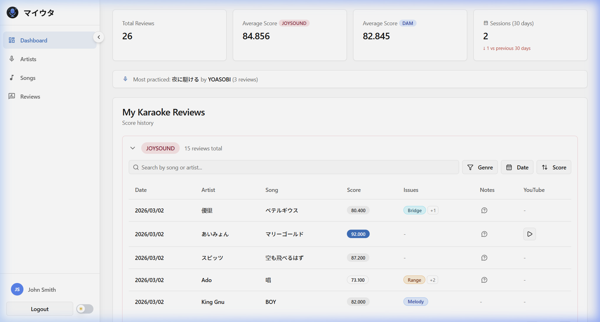

# マイウタ (MyUta)

[](https://github.com/steph-dm/MyUta/actions/workflows/ci.yml)
[](https://go.dev/)

Karaoke score tracker for DAM, JOYSOUND and K-STAGE. Log every take with its score, key and
score breakdown, tag what went wrong (pitch, rhythm, chorus…), set goals and watch your
progress per song and machine. English and Japanese.

<p align="center">
  
</p>

## What it does

- Log as many takes per day as you like, on DAM, JOYSOUND or K-STAGE (scores of different
  machines are kept apart; they are not comparable)
- Key change, version (e.g. a K-STAGE difficulty), notes and the machine's score breakdown
- Personal bests, goals per song and machine, charts per song
- Read a result from a photo or screenshot (optional, Anthropic API); on Android, share a
  photo from the Gallery or Google Photos straight to the installed app (HEIC photos are
  converted automatically)
- Find the song on YouTube (optional, YouTube Data API) and practise along in the player,
  including a queue of all favourites
- Search that ignores letter width and hiragana/katakana (あいどる finds アイドル)
- Export and import (JSON and CSV), password reset and e-mail confirmation (optional, SMTP)

## Stack

**Backend:** Go 1.26, GraphQL (gqlgen), PostgreSQL 16, Bun, goose migrations
**Frontend:** React 19, TypeScript, Vite, Tailwind, Radix/shadcn, Apollo Client, i18next
**Auth:** server-side sessions in an HttpOnly cookie, bcrypt, rate limits, CSRF header
**Infra:** Docker, nginx, GitHub Actions; deploys on Railway

## Getting started (development)

Requirements: Docker, Go 1.26+, Node 22+ with **npm 11** (`npm install -g npm@11`).

```bash
cp .env.example .env               # compose settings (database password, JWT secret…)
cp backend/.env.example backend/.env
make db                            # PostgreSQL in Docker
make dev-backend                   # API on http://localhost:4000 (GraphiQL in development)
make dev-frontend                  # app on http://localhost:3000
make seed                          # optional demo data
```

Migrations run when the server starts. Demo login after `make seed`:
`taro.tanaka@example.com` / `Demo-karaoke-2026` (never load the seed into a public instance).

## Commands

```bash
make help              # all targets
make test              # unit tests (backend + frontend)
make test-integration  # backend tests against PostgreSQL (throwaway databases)
make lint              # golangci-lint, ESLint, Prettier, tsc, translation check
make codegen           # regenerate GraphQL code after changing backend/schema.graphql
make check             # everything CI runs
make up                # full stack in Docker on http://localhost:3000
```

## Self-hosting and deployment

- [docs/deployment.md](docs/deployment.md): Docker Compose, Railway, upgrading from 1.x
- [docs/adding-a-machine.md](docs/adding-a-machine.md): support another karaoke machine
- [docs/architecture.md](docs/architecture.md): how the parts fit together
- [docs/upgrades.md](docs/upgrades.md): plan for major dependency upgrades, licence notes
- [CONTRIBUTING.md](CONTRIBUTING.md) and [SECURITY.md](SECURITY.md)

## Privacy

Analytics are off unless `VITE_UMAMI_*` is set at build time. When enabled, Umami
(cookieless) counts page views and feature use; no song titles, names, notes or e-mail
addresses are sent. Photos sent for score reading go to the Anthropic API and are not
stored by MyUta.

## License

Copyright © 2026 steph-dm. All rights reserved.
